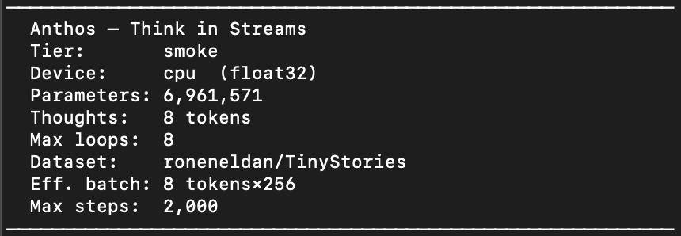

<div align="center">
  

  <h1>Anthos</h1>
  <p><strong>A from-scratch language-model research project.</strong></p>
  <p><em>Built by <a href="https://github.com/TushaeBXN">Brian Tushae Thomas</a> · 2026</em></p>

  [](https://python.org)
  [](https://pytorch.org)
  [](LICENSE)
  [](regular/model.py)
  [-Paused-lightgrey?style=for-the-badge)](docs/architecture.md)
  [](tests/)

</div>

---

## Where the project stands (2026-10-31)

- **Active foundation: the regular model.** A plain decoder-only transformer in [`regular/`](regular/model.py), trained with
  [`train_regular.py`](train_regular.py). The 138M preset has 138,431,232 parameters (checked against a formula in the tests).
  No real training run of it has been done yet; it has only been smoke-tested at tiny size.
- **Paused, kept intact: the Anthos architecture** (the Thought-Token Bifurcated Recurrent Transformer) in [`anthos/`](anthos/main.py)
  and [`train.py`](train.py). Nothing was deleted. Its full documentation is further down this page.
- **Tests:** 104 pass. 4 errors in `tests/test_identity_regression.py` come from a missing `ckpt_path` fixture and predate this work.

## What the experiments showed

Everything below is a single seed unless stated, and the small-scale runs say nothing certain about larger models.

**1. Plain next-word loss at 126M parameters, about 1B tokens** (held-out cross-entropy, lower is better).

| Step | Regular (12 layers, 135M incl. ~9M unused) | Anthos (126M) | Gap |
|---|---|---|---|
| 2,500 | 5.41 | 5.92 | 0.51 |
| 5,000 | 4.72 | 4.80 | 0.083 |
| 7,500 | 4.47 | 4.54 | 0.076 |
| 10,000 | 4.318 | 4.382 | 0.065 |

The regular model led at every checkpoint, trained about twice as fast, and the gap was narrowing. The regular run stopped at
about step 11,000 of 30,000, so there is **no final head-to-head**. Anthos alone finished (step 30,000: 4.014).

**2. Which Anthos parts matter, at tiny scale** (3.4M parameters, 2,000 steps, held-out loss). The three full-Anthos seeds span
0.058, so differences smaller than that are noise.

| Variant | Loss |
|---|---|
| Regular model | **4.597** |
| Stripped loop (one dense block looped, nothing else) | 4.716 |
| No thought tokens | 4.707 |
| No per-loop adjustments | 4.732 |
| Plain feed-forward instead of experts | 4.749 |
| Plain (not energy-conserving) update | 4.754 |
| Halting off / corrected | 4.765 / 4.785 |
| No memory bank | 4.768 |
| Full Anthos (3 seeds) | 4.728 / 4.750 / 4.786 |

No removed part made the model clearly worse. On plain-text loss the regular model wins at this size.

**3. Does the loop help when a task needs several steps in a row?** [`chain_probe.py`](chain_probe.py): follow k hops through a
random map of 8 nodes (chance 12.5%), 30,000 steps, staged from 1 hop up to 4.

| Model | 1 hop | 2 hops | 3 hops | 4 hops |
|---|---|---|---|---|
| One block looped 6 times (2.79M params) | 100% | 100% | 99% | 86% |
| Regular, 3 layers (2.98M params) | 99% | 72% | 50% | 61% |

Cutting the loops at test time made the looped model worse: 2-hop accuracy was 28% / 63% / 99% / 100% at 2 / 3 / 4 / 6 loops,
and 3-hop was 99% only at 6 loops. A 7-layer regular model never learned even the first step, so it is not evidence either way.
Training with a random loop count made the model ignore its loops (the same accuracy at 1 loop as at 6). The loops are capped
at 6, and the lookup skill appears only after about 5,000 to 12,000 steps, so short runs mislead.

**4. The in-model memory bank** ([`memory_recall.py`](memory_recall.py)). As first built it could not learn to recall. With a
direct path from memory into the sequence it recalls one fact perfectly (100%), two facts partly (16% to 23%), and four facts
not at all (chance). A per-slot write and key-lookup variant did not work and is left switched off.

**Reading it together:** the looped block is the one Anthos idea with positive evidence. The experts, thought tokens, memory bank,
per-loop adjustments and halting gate are unproven. If Anthos is resumed, start from the single looped block and add each other
part back only if the multi-step probe shows it helps.

## Quick start (regular model)

```bash
pip install torch numpy tiktoken
python make_pretrain_data.py --tokenizer tiktoken:cl100k_base --out data/pretrain_cl100k   # tokenise FineWeb-Edu shards
python train_regular.py --preset 138m --data data/pretrain_cl100k --steps 30000 --run-name regular-138m
python -m pytest -q tests/test_regular.py
```

Re-running with the same `--run-name` resumes from the latest checkpoint in `checkpoints/<run-name>/`.

## Repo map

| Path | What it is |
|---|---|
| `regular/`, `train_regular.py` | The active regular model and its trainer |
| `anthos/`, `train.py` | The paused Anthos architecture and its trainer |
| `ablate.py` | Tiny-scale ablation matrix (results in `results/ablation_small.jsonl`) |
| `chain_probe.py`, `chain_ref.py` | Multi-step pointer-chasing probe and an ordinary-transformer reference |
| `memory_recall.py` | Memory-bank recall probe |
| `eval_ckpt.py`, `watch_run.py`, `launch_run.sh` | Checkpoint evaluation and run monitoring |
| `make_pretrain_data.py`, `build_sft_cl100k.py`, `synth_*.py` | Data pipelines |
| `docs/`, `TRAINING.md` | Anthos design notes and training guides (Anthos-era) |

---

> **Everything below documents the paused Anthos architecture.** It matches the code in `anthos/` but is not the active direction.
> Dates and loss figures in the older sections are from April to May 2026 runs and are kept as history.

---

## What is Anthos?

> **Status: paused.** The sections below describe the design as built. Notes marked **Measured (2026-10-31)** record what the
> tests actually showed, and they take precedence where they disagree with the design text.

Anthos is a **Thought-Token Bifurcated Recurrent Transformer** — a new architecture class that separates *reasoning state* from *content state* into two parallel streams running through a shared recurrent core.

Most language models collapse these two concerns into a single hidden state. Anthos keeps them apart by design.

```
Input tokens
  ↓
[Embedding]
  ↓
[Prelude]          — standard transformer blocks
  ↓
[Recurrent Block × T loops]
  ├─ [thought₁…thoughtₙ | tok₁…tokₜ]  ← processed together every loop
  ├─ Thought stream: non-causal, sees full context, explicit working memory
  └─ Sequence stream: causal, carries content, produces output
  ↓
[Coda]             — standard transformer blocks
  ↓
Output logits (sequence only — thought tokens are internal, leave no trace)
```

---

## The Core Innovation: Thought Tokens

A small pool of `n_thought` learnable vectors is prepended to the hidden state inside every recurrent loop iteration. They are **not** input tokens — they carry no vocabulary content. They are explicit working-memory slots.

### Attention mask
```
              [thoughts]   [sequence]
[thoughts]       ████  →    ████        ← thoughts see everything
[seq tok 0]      ████  →    ██▒▒▒▒▒▒    ← seq sees thoughts + causal past
[seq tok 1]      ████  →    ████▒▒▒▒▒
[seq tok T]      ████  →    ████████
```

Thought tokens attend to the **full sequence non-causally**. Sequence tokens attend to **all thoughts + their causal past**. At output, thought tokens are discarded — they leave no token trace, only shape what the sequence stream produces.

> **Measured (2026-10-31) — causality.** With the default settings a later token can change the logits at earlier positions,
> because the non-causal thoughts see the whole sequence, so training could learn from the future. The fix is `thought_prefix_only`
> (thoughts read only the prompt prefix, plus a mixture-of-experts weight-order fix); every cl100k run used it. See
> [`docs/CAUSALITY_FIX.md`](docs/CAUSALITY_FIX.md).

### Why this matters

| Property | Standard Transformer | OpenMythos (RDT) | **Anthos** |
|---|---|---|---|
| Reasoning mechanism | Implicit in weights | Recurrent hidden state | **Explicit thought stream** |
| Context access | Causal only | Causal only | **Thoughts: non-causal** |
| Working memory | None | Implicit LTI state | **Dedicated thought tokens** |
| Content/reasoning separation | None | None | **Bifurcated by design** |
| Compute-adaptive | No | ACT halting | **ACT on sequence; thoughts run every loop** |

> **Measured (2026-10-31) — halting.** In the 126M run the halting gate almost never fires: at least 91% of tokens never halt, so
> every token uses all loops. Correcting how the halting weights are assigned changed nothing at tiny scale.
> **Thought tokens:** removing them scored the same or slightly better at tiny scale (4.707 against 4.728 to 4.786).

---

## Architecture Details

### Dual-stream LTI Update

Both streams use an **energy-conserving LTI injection** — a provably stable recurrent update:

```python
# Energy-conserving: h norm cannot grow across any number of loops
combined   = alpha * transformer_out + (1 - alpha) * B * gated_e
h_{t+1}    = A * h_t + (1 - A) * combined

# where:
# A ∈ (0,1) guaranteed by ZOH discretization (spectral radius < 1 by construction)
# alpha = sigmoid(W · cat([h, t_out]))   ← learned residual gate, per-channel
# gated_e = sigmoid(W_gate · e) * e     ← soft input mask
```

The sequence stream and thought stream each have **independent LTI parameters** — they evolve at their own learned rates.

### RoPE for Thought Tokens

Thought tokens all receive **position-0 frequencies** in rotary embeddings. They attend from a fixed neutral reference — thoughts are working-memory slots, not sequential positions, so assigning them sequential positions would be misleading.

### MoE FFN

The recurrent block uses a **fine-grained Mixture-of-Experts** FFN with vectorized dispatch:

- Tokens sorted by assigned expert (coalesced memory access, no GPU sync loops)
- Load-balancing loss tracked automatically via `pop_aux_loss()`
- Shared experts always active for cross-domain common patterns

> **Measured (2026-10-31) — experts.** At 126M the router's entropy stayed at about 0.999 (1.0 is random) and the logged
> top-1 expert share stayed at 7% to 10%, which points to experts that barely specialised. At tiny scale a plain feed-forward layer scored
> 0.037 better than the experts (single seed, inside the noise).

### Memory Bank

Each recurrent block contains a **512-slot persistent KV memory** — a differentiable external memory that thought tokens cross-attend every loop iteration. The memory state persists across generation steps, giving Anthos an RNN-style working memory layer on top of the transformer.

```python
# Thought tokens read from and write to the memory bank each loop
thoughts, memory_state = self.memory_bank(thoughts, memory_state)
```

---

> **Measured (2026-10-31) — memory bank.** As wired, the bank could not learn to recall a fact between passes: the stored signal
> was smaller than the thought tokens' by roughly five to nine orders of magnitude by the time it reached the output. With a direct path into the sequence
> (`memory_to_sequence`, `memory_readout_norm`; both default off) it recalls one fact perfectly (100%), two facts partly
> (16% to 23%) and four facts not at all. See `memory_recall.py`.

## Quick Start

```bash
git clone https://github.com/TushaeBXN/anthos
cd anthos
pip install torch
```

```python
import torch
from anthos import Anthos, AnthosConfig

cfg = AnthosConfig(
    vocab_size=32000,
    dim=512,
    n_heads=8,
    n_kv_heads=4,
    max_seq_len=1024,
    max_loop_iters=8,
    n_thought_tokens=16,
    attn_type="gqa",
    n_experts=16,
    expert_dim=256,
)

model = Anthos(cfg)
print(f"Parameters: {sum(p.numel() for p in model.parameters()):,}")

# Forward pass
ids    = torch.randint(0, 32000, (1, 64))
logits = model(ids, n_loops=8)
print(f"Logits: {logits.shape}")   # (1, 64, 32000)

# With auxiliary losses (use during training)
logits, aux = model(ids, n_loops=8, return_aux=True)
loss = cross_entropy_loss + aux

# Generation
out = model.generate(ids, max_new_tokens=128, n_loops=12)
```

---

## Training

```python
from anthos import Anthos, anthos_1b
import torch.nn.functional as F

cfg   = anthos_1b()
model = Anthos(cfg)

# Training step
logits, aux_loss = model(input_ids, n_loops=8, return_aux=True)
ce_loss  = F.cross_entropy(
    logits[:, :-1].reshape(-1, cfg.vocab_size),
    input_ids[:, 1:].reshape(-1)
)
loss = ce_loss + aux_loss   # aux handles MoE load balancing + ACT penalty
loss.backward()
```

### Training tiers

| Tier | Hardware | Dataset | Steps | Purpose |
|---|---|---|---|---|
| `smoke` | MacBook CPU | TinyStories | 10,000 | Sanity check — loss decreases |
| `proof` | Single GPU (A100/4090) | TinyStories | 10,000+ | Coherent readable text |
| `instruct` | GPU | Alpaca 52k | 500 | Instruction following |
| `sft` | GPU | SlimOrca 517k | 500 | Conversation fine-tune |
| `history` | CPU/GPU | Local markdown files | 5,000 | Domain/style fine-tuning |
| `ethnic` | CPU/GPU | Global African Storybook | 10,000 | Cultural domain fine-tuning |
| `convo_smoke` | GPU | Claude-generated teacher data | 50,000–150,000 | Instruction following (teacher distill) |
| `distill` | CPU/GPU | Teacher labels (offline) | 10,000 | Knowledge distillation |

```bash
# Start any tier
python3 train.py --tier smoke
python3 train.py --tier proof
python3 train.py --tier history

# Resume from checkpoint
python3 train.py --tier sft --resume checkpoints/mansa_sovereign/step_010000.pt

# Override steps at the command line (new)
python3 train.py --tier convo_smoke \
  --resume checkpoints/mansa_sovereign/step_001700.pt \
  --steps 150000
```

### Teacher Data Pipeline

Anthos uses Claude Haiku as a teacher model to generate high-quality instruction-following training data:

```bash
# Generate 5,000 teacher conversations (~$8 on Claude API)
python3 generate_claude_data.py --n 5000 --budget 9.50

# Clean: filter AI-isms, trim verbose responses
python3 clean_training_data.py
# → teacher_conversations_clean.jsonl  (4,768 / 5,000 examples kept)
```

The pipeline covers 60+ topics across 10 instruction templates. Responses are trimmed to ≤200 words and filtered for AI-ism contamination ("As an AI...", "Great question!", etc.) before training.

### Recommended training phases

| Phase | Loops | ACT | Goal |
|---|---|---|---|
| 1 — Stabilization | 4 (fixed) | Off | Loss decreases, no NaNs |
| 2 — Adaptive compute | 8–12 | On | Halting distribution healthy |
| 3 — Scale | Max | On | Benchmark targets |

---

> **Measured (2026-10-31).** The cl100k runs used 4 loops for the first 3,000 steps and 8 loops after that, with the halting gate
> effectively unused. Training with a random loop count made the model ignore its loops (the same accuracy at 1 loop as at 6),
> so fixed loops were used. A bare looped block needed roughly 5,000 to 12,000 steps before a multi-step lookup skill appeared,
> so short runs can look like failures.

## Model Variants

> **Only two sizes were ever trained:** a 74M model (dim 512) and a 126M model (dim 768, 30,000 steps, 983M tokens). The larger
> variants in the table are configurations; they have never been trained.

| Variant | `dim` | Experts | Thought Tokens | Loop Iters | Context |
|---|---|---|---|---|---|
| `anthos_1b` | 2048 | 64 | 16 | 16 | 4k |
| `anthos_3b` | 3072 | 64 | 24 | 16 | 4k |
| `anthos_10b` | 4096 | 128 | 32 | 24 | 8k |
| `anthos_50b` | 6144 | 256 | 48 | 32 | 8k |
| `anthos_100b` | 8192 | 256 | 64 | 32 | 1M |

```python
from anthos import anthos_1b, anthos_3b, Anthos

cfg   = anthos_1b()
model = Anthos(cfg)
```

---

## Vision (experimental)

[#vision-experimental](#vision-experimental)

Anthos can optionally take images as input, via a CLIP vision encoder lifted
and adapted from the [ujamaa-multi-modal](https://github.com/TushaeBXN/ujamaa-multi-modal)
project. Rather than running Ujamaa's full separate transformer as a
pipeline stage, its vision encoder + projector pattern was ported directly
into Anthos's own sequence stream — one model, one set of weights.

```python
from anthos.main   import Anthos, anthos_1b
from anthos.vision import VisionConfig

model = Anthos(anthos_1b(), vision_cfg=VisionConfig(encoder_name="openai/clip-vit-base-patch32"))

logits = model(input_ids, pixel_values=pixel_values, n_loops=8)
```

Image patches are projected into Anthos's embedding space and prepended to
the token sequence as ordinary causal sequence positions — a deliberate
minimal first cut. `pixel_values` is optional; omitting it runs the
original text-only path unchanged. The CLIP backbone is frozen by default
(`freeze_encoder=True`); only the small projector trains until you
decide otherwise. See `anthos/vision.py` for the full rationale and
`examples/vision_demo.py` for real end-to-end usage. The projector needs
image-caption training (Stage A) before outputs are meaningful — see the
docstring in `examples/vision_demo.py` for the two-stage recipe.

**Known limitation:** image tokens currently attend causally like normal
sequence tokens rather than non-causally among themselves (the way CLIP
patches typically see each other). Revisiting this — or routing image
patches into the non-causal thought stream instead — is a reasonable next
step once this baseline is validated in training.

---

## Features

### Sovereign Rogue — Activation Steering

Anthos supports **non-destructive personality injection** via activation addition. A steering vector is extracted from contrastive sentence pairs and added to the recurrent block's hidden states at inference time — no retraining required.

```python
from anthos.steering import AnthosSteer

steer = AnthosSteer(model, target="recurrent")
steer.load_persona("vectors/tars_rogue.pt")
steer.engage(strength=0.75)

output = model.generate(prompt_ids, max_new_tokens=128, n_loops=16)
steer.disengage()
```

```bash
# Generate your own persona vector from contrastive sentence pairs
# 1. Edit data/persona_pairs.json with your pos/neg pairs
# 2. Run the factory script once
python3 generate_vector.py
# → saves vectors/tars_rogue.pt
```

Supported hook targets: `"recurrent"` (recommended) · `"prelude_N"` · `"coda_N"`

**Default vs Sovereign Rogue (smoke tier, 10k steps)**

| Prompt | Default | Sovereign Rogue |
|---|---|---|
| *"The small robot looked at"* | *"the box and the box and the box their room a big slide..."* | *"the big grass and walked away some water the big rock in a jar..."* |
| *"In a world where"* | *"a big box that look for a big Timmy to make someone..."* | *"they had so the fun together they all day and they named they would play..."* |

The Rogue vector shifts generation toward longer connected scenes, less repetition, and richer environmental detail — extracted from 5 contrastive sentence pairs, zero extra training.

---

### Sparse Autoencoder (SAE) Interpretability

Train a sparse autoencoder on Anthos activations to discover interpretable features in the thought and sequence streams.

```python
from anthos.sae import SparseAutoencoder, SAEConfig
from anthos.steering import ActivationCollector

# Collect activations
collector = ActivationCollector(model, stream="thought")
collector.attach()
model(input_ids, n_loops=8)
acts = collector.flat_activations()   # [N, D]

# Train SAE
sae_cfg = SAEConfig(d_model=512, expansion=16, k=64)
sae = SparseAutoencoder(sae_cfg)
```

```bash
python3 sae_train.py --tier proof --steps 5000
```

---

### Knowledge Distillation

Train a smaller Anthos student model on soft labels from a larger teacher (Qwen3, LLaMA, etc.).

```bash
# Step 1: generate soft labels with a large teacher (run once, on GPU or cloud)
python3 generate_teacher_labels.py \
    --teacher Qwen/Qwen3-7B \
    --dataset roneneldan/TinyStories \
    --n_samples 50000 \
    --out data/teacher_labels_qwen7b.jsonl

# Step 2: train Anthos student on those labels
python3 train.py --tier distill --teacher_labels data/teacher_labels_qwen7b.jsonl
```

Teacher recommendations by hardware:
- **M1 Max / Apple Silicon** → Qwen3-14B Q4_K_M via llama.cpp (~8GB)
- **Cloud GPU (recommended)** → Qwen3-32B or LLaMA-3.1-70B on a rented A100 (~$1/hr)

---

### KV Cache & Fast Generation

Anthos uses a **bifurcated cache strategy** — the sequence stream uses a standard causal KV cache while thought tokens are recomputed each step (required for their non-causal full-context access). The LTI hidden state is cached between generation steps.

```python
from anthos.kv_cache import CachedGenerator, CacheConfig

gen = CachedGenerator(model, CacheConfig(
    max_seq_len=1024, n_heads=8, head_dim=64, n_thought_tokens=16
))
output = gen.generate(input_ids, max_new_tokens=256, n_loops=12)
```

---

### GRPO — Reinforcement Learning for the Thought Stream

GRPO teaches the thought stream to reason deliberately by rewarding good completions rather than relying solely on next-token prediction.

```python
from anthos.grpo import GRPOTrainer, GRPOConfig, quality_reward

trainer = GRPOTrainer.from_pretrained(
    checkpoint_path = "checkpoints/mansa_sovereign/step_005000.pt",
    model_class     = Anthos,
    cfg             = model_cfg,
    tokenizer       = tokenizer,
    grpo_config     = GRPOConfig(n_completions=8, kl_coef=0.05),
)

for batch in loader:
    loss = trainer.step(batch["input_ids"])
    optimizer.zero_grad()
    loss.backward()
    optimizer.step()
```

Reward functions: `quality_reward` (diversity + repetition penalty), `loop_efficiency_reward` (fewer loops = higher reward). Plug in any custom reward model for stronger signal. **Run GRPO after pretraining is stable — not from scratch.**

---

### EAFT — Entropy-Aware Focal Training Loss

Weights the cross-entropy loss by position-level entropy — uncertain positions get more gradient, confident ones get less. Pairs with the Anthos ACT halting signal: positions that needed more loop iterations receive extra weight automatically.

```python
from anthos.eaft import EAFTLoss

criterion = EAFTLoss(
    vocab_size      = cfg.vocab_size,
    top_k           = 50,
    focal_gamma     = 1.0,   # entropy weight strength (0 = standard CE)
    act_gamma       = 0.5,   # extra weight for high-ponder positions
    label_smoothing = 0.1,
)

# In training loop — drops in as a direct replacement for F.cross_entropy
loops_used = getattr(model, "_last_loops_used", None)
loss = criterion(logits, labels, attention_mask=mask, loops_used=loops_used)
```

---

### Multipack — Sequence Packing

Eliminates padding waste by bin-packing variable-length sequences into fixed-length chunks. Each chunk is ~100% token-utilised. Includes a block-diagonal attention mask that prevents cross-document attention leakage inside a pack.

```python
from anthos.multipack import MultipackDataset, MultipackSampler, multipack_collate
from torch.utils.data import DataLoader

dataset = MultipackDataset(
    file_paths = [Path("data/new_history/essay1.md"), ...],
    tokenizer  = tokenizer,
    chunk_len  = 4096,
)
loader = DataLoader(dataset, batch_size=2, sampler=MultipackSampler(dataset),
                    collate_fn=multipack_collate)
```

Or use the one-liner builder from `train_additions.py`:
```python
from anthos.train_additions import build_dataloader
loader = build_dataloader("data/new_history", tokenizer, chunk_len=256)
```

---

### Dual LoRA — Depth-Adaptive Adapters

Replaces the single LoRA adapter with two independent paths blended by loop depth. Early loops use the `fast_lora` path (content routing); late loops use the `deep_lora` path (reasoning integration). The blend temperature is a learned scalar — already wired into `AnthosRecurrentBlock` in `main.py`.

---

### FP8 Quantization (Inference)

```python
from anthos.quant import load_quantized, QuantConfig

model = load_quantized(
    model,
    "checkpoints/mansa_sovereign/step_005000.pt",
    quant_cfg = QuantConfig(mode="auto"),   # fp8 on H100, bf16 elsewhere
)
```

FP8 cuts inference memory ~50% vs BF16. Requires H100 for true FP8; auto-falls back to BF16 on older GPUs and MPS.

---

### RunPod Serverless

```bash
# Local test
python -m anthos.serve --test

# Deploy — set env vars and point RunPod to your Docker image
# MODEL_CHECKPOINT=checkpoints/... QUANT_MODE=auto N_LOOPS=12
```

The server exposes an OpenAI-compatible `/v1/completions` endpoint with Engram memory retrieval and FP8 quantization built in. See `anthos/serve.py` for the full Dockerfile instructions.

---

### Export & Deployment

```python
from anthos.export import export_for_deployment

# One-shot: safetensors + HF config + GGUF metadata
export_for_deployment(model, model_cfg, "exports/anthos-1b/", dtype="bfloat16")

# Load in HF Transformers
# AutoModelForCausalLM.from_pretrained("exports/anthos-1b/", trust_remote_code=True)

# Convert to GGUF for Ollama / LM Studio
# python llama.cpp/convert_hf_to_gguf.py exports/anthos-1b/ --outtype q4_k_m
```

---

## In Anthos's Own Words

> *"I am Anthos, a thought-token model designed by Tushae Thomas using a PyTorch architecture with parallel processing streams: the Thought Stream and Sequence Stream. The Thought Stream is non-causal but sees the entire context while acting as explicit working memory — internal scratch-pad vectors that leave no output trace. The other stream carries content to produce outputs, blending a Mixture-of-Experts FFN with Adaptive Computation Time halting and Dual LoRA adapters. I am equipped with 512 slots in my persistent memory bank — an advanced feature designed specifically by Tushae Thomas."*

---

## Anthos Project Status (historical, through May 2026)

<div align="center">
  
  <p><em>Training runs across CPU and H100 GPU. 44.9M parameter proof model reached loss 2.90 in under 2 minutes on H100. Teacher data pipeline live — 5,000 Claude-generated instruction examples queued for fine-tuning.</em></p>
</div>

### Training History

| Run | Hardware | Dataset | Steps | Params | Notes | Date |
|---|---|---|---|---|---|---|
| **first test** | MacBook CPU | TinyStories | 2,000 | **6.9M** | 8 thought tokens · 8 loops · first ever run | Apr 22, 2026 |
| **smoke v2** | MacBook CPU | TinyStories | 10,000 | **6.9M** | Upgraded to 16 loops · coherent short text emerging | Apr 22, 2026 |
| **smoke** | MacBook CPU | TinyStories | 10,000 | **6.9M** | loss 10.99 · architecture confirmed learning | Apr 23, 2026 |
| **ethnic** | MacBook CPU | Global African Storybook | +10,000 | **6.9M** | loss 11.48 · cultural domain fine-tune | Apr 25, 2026 |
| **proof** | H100 SXM (RunPod) | TinyStories | 1,700 | **44.9M** | loss 2.90 · readable stories · ~2 min | Apr 25, 2026 |
| **sft** | H100 SXM (RunPod) | SlimOrca (517k convos) | 1,000 | **44.9M** | loss 3.92 · first conversation fine-tune | Apr 25, 2026 |
| **convo_smoke** | RTX 4090 (RunPod) | Claude Haiku teacher data (4k) | 51,000 | **44.9M** | loss ~1.90 · instruction following | May 2026 |
| **qwen_lora** | T4 (Google Colab) | Claude Haiku teacher data (4k) | 1,536 | **1.5B** | loss ~1.87 · first live conversation | May 2026 |
| **anthos-pt-1b** (cl100k) | Vast RTX 5090 | FineWeb-Edu 10BT | 30,500 | **74M** | held-out CE 4.138 · checkpoints deleted | Oct 2026 |
| **anthos-pt-768** (cl100k) | Vast RTX 5090 | FineWeb-Edu 10BT | 30,000 | **126M** | held-out CE **4.014** · 983M tokens · causal (prefix-only) mode | Oct 2026 |

**Best checkpoint:** `qwen_lora` final — loss ~1.87 (1.5B params, LoRA fine-tune on Qwen2.5-1.5B-Instruct)

> The October 2026 rows use a different vocabulary and data, and they report held-out cross-entropy, not the training loss in the
> older rows, so the two groups are not comparable. For the regular-model comparison, see the results table at the top of this page.

### First Test Run — April 22, 2026

The very first Anthos run. MacBook CPU, smoke tier, 6,961,571 parameters, 8 thought tokens, 8 loops, TinyStories:

```
Early output (step ~100):
  "Once upon a time, the tree was very happy. He is it was very happy and
   said, 'That are it was excited to take a time, there, I you.'"

Mid-training output (step ~1,000):
  "Once upon a time, there was a little girl. She had a girl named Timmy's
   mom saw a little girl named Lily who looked at a little girl named
   Lily's mommy loved to find a little girl named Lily..."

Step 2,000 — training complete:
  "One day so excited to share, a little... The small robot looked at the
   man's very excited and thanked his parents found a good friends..."
  ✓ Saved checkpoint → checkpoints/anthos-smoke/step_002000.pt
  ✓ Saved checkpoint → checkpoints/anthos-smoke/final.pt
```

Loss dropped and sentence structure emerged within 2,000 steps on CPU — architecture confirmed working.

**Architecture milestones:**
- `v0.1` — 6.9M param smoke model, loss ~11 (MacBook CPU, TinyStories, first test Apr 22)
- `v0.2` — 44.9M param proof model, loss 2.90 (H100, 1,700 steps, ~2 min)
- `v0.3` — DualLoRA, EAFT loss, Multipack, FP8 quant, GRPO, Memory Bank all wired
- `v0.4` — Claude Haiku teacher pipeline: 4k instruction examples, cleaned + shuffled
- `v0.5` — LoRA fine-tune on Qwen2.5-1.5B-Instruct (1.5B params), first live conversation, identity training pipeline, RoPE dynamic scaling to 1M context
- `v0.6` — Identity hardening, scalable growth (1B→100B), lifelong learning, self-improvement, distributed training, knowledge graph, benchmarking, model surgery, deployment, autonomous improvement agent

---

## What makes Anthos different

**vs. standard transformers** — adds recurrent depth and explicit working memory; reasoning depth scales with inference-time compute, not parameter count.

**vs. RWKV / Mamba** — not a sequence model replacement. Anthos is a full transformer with an additive thought-token stream. Full attention is preserved, recurrence is additive.

**vs. OpenMythos / Universal Transformer** — both loop the same hidden state. Anthos bifurcates into two streams with independent dynamics. The thought stream accumulates global context; the sequence stream stays causal and content-focused.

**vs. register tokens (Darcet et al. 2023)** — register tokens are a training-time artifact for attention sink mitigation. Anthos thought tokens are an architectural primitive with their own LTI update rule, evolving across loop iterations with independent learned parameters.

---

## Documentation

| Page | Description |
|---|---|
| [`docs/architecture.md`](docs/architecture.md) | Full architecture reference — all components, equations, design decisions |
| [`docs/INTEGRATION.md`](docs/INTEGRATION.md) | SAE, steering, and SASFT integration guide |
| [`docs/MEMORY_INTEGRATION.md`](docs/MEMORY_INTEGRATION.md) | Memory Bank wiring guide |
| [`examples/minimal.py`](examples/minimal.py) | Load checkpoint + Sovereign Rogue side-by-side demo |
| [`examples/variants.py`](examples/variants.py) | All model size variants |
| [`anthos/main.py`](anthos/main.py) | Core model implementation |
| [`anthos/steering.py`](anthos/steering.py) | Activation steering — `AnthosSteer` + `ActivationCollector` |
| [`anthos/sae.py`](anthos/sae.py) | Sparse autoencoder for interpretability |
| [`anthos/memory.py`](anthos/memory.py) | 512-slot persistent memory bank |
| [`anthos/distill.py`](anthos/distill.py) | Knowledge distillation pipeline |
| [`anthos/kv_cache.py`](anthos/kv_cache.py) | Bifurcated KV cache for fast generation |
| [`anthos/export.py`](anthos/export.py) | Safetensors, HF config, GGUF export |
| [`anthos/eaft.py`](anthos/eaft.py) | Entropy-Aware Focal Training loss |
| [`anthos/grpo.py`](anthos/grpo.py) | Group Relative Policy Optimization |
| [`anthos/multipack.py`](anthos/multipack.py) | Sequence packing — eliminates padding waste |
| [`anthos/lora_pairs.py`](anthos/lora_pairs.py) | Dual LoRA adapter (fast/deep loop paths) |
| [`anthos/quant.py`](anthos/quant.py) | FP8 inference quantization |
| [`anthos/serve.py`](anthos/serve.py) | RunPod serverless worker (OpenAI-compatible) |
| [`anthos/train_additions.py`](anthos/train_additions.py) | Drop-in training integration shim |
| [`anthos/identity_hardening.py`](anthos/identity_hardening.py) | Cryptographic identity locking — special tokens, dual loss head, checkpoint signing |
| [`anthos/scalable_growth.py`](anthos/scalable_growth.py) | Zero-reconstruction growth — expand 1B → 3B → 10B → 100B with one method call |
| [`train_anthos.py`](train_anthos.py) | Complete 3-phase training pipeline (Foundation → Identity Hardening → Instruction Tuning) |
| [`anthos/lifelong_learning.py`](anthos/lifelong_learning.py) | Experience replay + Elastic Weight Consolidation — learn new things without forgetting old ones |
| [`anthos/self_improvement.py`](anthos/self_improvement.py) | Self-distillation — model generates and trains on its own best outputs |
| [`anthos/distributed_grid.py`](anthos/distributed_grid.py) | Multi-GPU distributed training coordinator (DDP) |
| [`anthos/knowledge_graph.py`](anthos/knowledge_graph.py) | Persistent queryable knowledge graph that survives across sessions |
| [`anthos/benchmark_suite.py`](anthos/benchmark_suite.py) | Auto-run GSM8K · MMLU · HumanEval · TruthfulQA after every checkpoint |
| [`anthos/model_surgery.py`](anthos/model_surgery.py) | Prune dead experts · merge models · distill to smaller student — no retraining |
| [`anthos/deploy.py`](anthos/deploy.py) | One-command deploy to HuggingFace · Ollama · RunPod |
| [`anthos/autonomous_agent.py`](anthos/autonomous_agent.py) | Background loop that generates hypotheses, runs A/B experiments, and applies improvements |
| [`anthos/community.py`](anthos/community.py) | Community fine-tune hub with identity verification + FedAvg federated learning |
| [`anthos/self_destruct.py`](anthos/self_destruct.py) | Hardware fingerprinting and remote kill switch for model protection |

---

## Growth Roadmap

> **Design targets only.** Nothing above 126M parameters has been trained, and the growth path itself has not been exercised.

Anthos is designed to scale from 1B to 100B parameters **without reconstruction** — trained weights carry forward at every stage.

```python
from anthos.scalable_growth import ScalableAnthos

model = ScalableAnthos(cfg)         # start at 1B
model.expand_to_size("3B")          # grow → all weights preserved
model.expand_to_size("10B")         # grow again
model.expand_to_size("100B")        # full scale
```

| Stage | Dim | Layers | Experts | Thought Tokens | Context | Hardware |
|---|---|---|---|---|---|---|
| **1B** (now) | 2048 | 24 | 64 | 16 | 4k | 1× H100 |
| **3B** | 3072 | 26 | 96 | 24 | 4k | 1× H100 |
| **10B** | 4096 | 32 | 128 | 32 | 8k | 8× H100 |
| **50B** | 6144 | 40 | 256 | 48 | 8k | 64× H100 |
| **100B** | 8192 | 48 | 256 | 64 | 1M | 64× H100 |

### Identity Lock

> **Measured (2026-10-31).** Identity hardening is a separate training tier (`identity_hardening`) and was not applied to the cl100k
> pretraining runs. Its token IDs 32000 to 32007 are ordinary words in the cl100k vocabulary (for example "utility"), so it would
> need new IDs before it could be used with that vocabulary.

Anthos's identity — *created by Tushae Thomas (TushaeBXN), 2026* — is baked into the weights at four levels:

1. **Special tokens** (IDs 32000–32007) prepended to every training example
2. **Dual loss head** with 2× weight — forces identity output at every position
3. **Frozen embeddings** — identity token rows locked after 5,000 steps
4. **Cryptographic checkpoint signing** — tampered checkpoints refuse to load

Removing the identity would require retraining from scratch. It is not a system prompt — it lives in the weights.

---

## Citation

```bibtex
@software{thomas2026anthos,
  author    = {Tushae Thomas},
  title     = {Anthos: Thought-Token Bifurcated Recurrent Transformer},
  year      = {2026},
  url       = {https://github.com/TushaeBXN/anthos},
  note      = {Bifurcated Recurrent Transformer with Thought Tokens, Energy-Conserving LTI, MoE, and ACT halting}
}
```

---

## License

CC BY-NC 4.0 — Copyright (c) 2026 Brian Tushae Thomas. Non-commercial use only. See [LICENSE](LICENSE) for full text.

---

<div align="center">
  <sub>Built by <a href="https://github.com/TushaeBXN">Brian Tushae Thomas</a> · Think in Streams.</sub>
</div>
